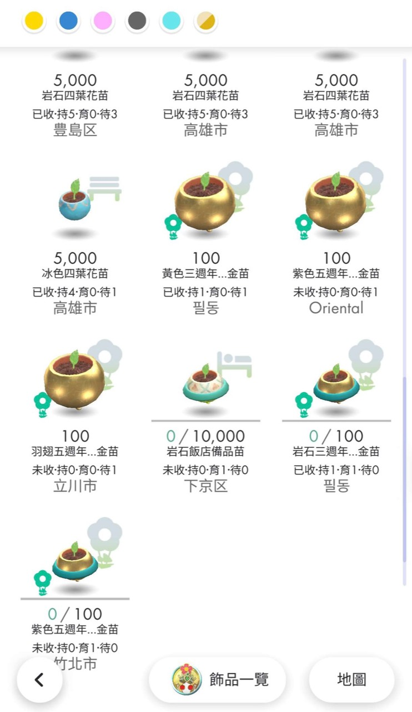
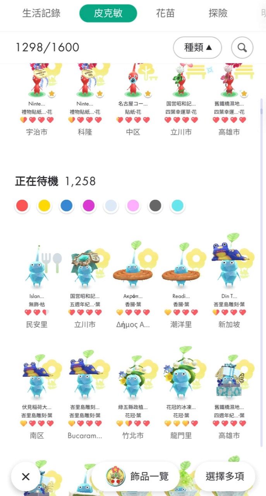

# 皮克敏花苗透視鏡

在 Pikmin Bloom 補充花苗、皮克敏、探險與精華資訊，並可複製探險座標。顯示關閉後還原原文字與字級。

<p align="center">
  
</p>

**[下載 0.14.1 預覽版 APK](https://github.com/odyliao-lab/pikmin-control-center-releases/releases/tag/seed-lens-v0.14.1)** · 開發者：odyliao-lab

0.14.1 對應遊戲 157.0；遊戲 156.1 使用[舊版 0.7.3 APK](https://github.com/odyliao-lab/pikmin-control-center-releases/releases/tag/seed-lens-v0.7.3)（僅花苗名稱顯示）。

## 四個功能開關

| 功能 | 顯示內容 |
|---|---|
| 花苗資訊 | 顏色、裝飾、收集與持有／育苗／待種統計、育苗詳細資訊 |
| 皮克敏資訊 | 目前花態、可收瓣／任務狀態、已取得裝飾 |
| 探險資訊 | 一般白盒對象與裝飾、探險狀態與遊戲剩餘時間 |
| 精華／花瓣對照 | 保留精華數量，補對應花瓣、容量與剩餘空間 |

0.14.1 包含[執行狀態與關閉全部](docs/STATUS_ALL_OFF.md)、[診斷與版本更新](docs/DIAGNOSTICS_UPDATES.md)，以及 [App 直接回報](docs/APP_DIRECT_UPLOAD.md)。在診斷頁預覽、選填 Email、同意後即可直接上傳，不需登入；離線匯出仍保留。

[診斷回報站](https://seed-lens-reports.ody-liao.chatgpt.site)也可上傳匯出的 JSON。Email 僅供修正通知，目前尚未接上寄信服務；管理後台僅限站長登入。[網站原始碼與限制](server/sites/README.md)。

工具頁直接開關，說明預設收合；診斷頁提供環境排除建議與檢查新版本。各項實測範圍見下表與[完整驗收矩陣](docs/DISPLAY_PORT_RESULTS.md)。

0.14.1 改為「先保存選擇，再動態套用」：遊戲未開或 Root／版本條件尚未就緒，也可先打開五個開關，App 另顯示等待原因。[操作與驗證](docs/FEATURE_INTENT.md)。

0.13.3 在四組下方新增「複製探險座標」，預設關閉。查看花苗／水果探險詳情或左右換卡停穩後，自動複製目前座標；不移動定位，座標不納入診斷或上傳。[操作與實測範圍](docs/GPS_COPY.md)。

[0.14.1 發布與驗證](docs/RELEASE_0141.md)。

## 使用方式

需要既有 **Root＋單一 APK**，不需其他 App、額外顯示模組或電腦注入。介面固定直式，不變更物品或執行遊戲操作。

1. 安裝透視鏡並允許 Root。
2. 選擇所需開關，完成首次自動套用確認；條件尚未就緒也能先保存 ON。
3. 保持遊戲在前景等待套用；卡片未更新時重新開啟列表。

0.14.1 已在 MuMu 12.0／15.0 驗證先選 ON、再開遊戲自行套用。ON 代表選擇，實際套用依狀態顯示；若結果不明或升級後仍載入舊版，依提示正常重開遊戲，不對同一程序重送載入。

## 已驗證環境

0.14.1：MuMu 內建12.0（API32）及15.0（API35）搭配精確157.0，通過預選開關、等待遊戲、自行載入、水果座標複製與OFF；API35另驗取消首次確認保留ON及重開App保存。[本版驗證界線](docs/FEATURE_INTENT.md)。

0.13.3 的座標複製已在 MuMu 內建 12.0（API32）及 15.0（API35）搭配遊戲 157.0 通過水果詳情 ON／OFF／再 ON；API35 另通過遊戲重啟自動重綁。[GPS 專項紀錄](docs/GPS_COPY.md)。下表保留四組資訊及舊版資格。

以下均為 **MuMu x86_64＋NativeBridge**。0.9.5 已實測花苗庫存統計、成年裝飾／葉與任務副標、待派期限、精華／花瓣對照的 ON／OFF；資格限這些樣本與表列流程。

| MuMu Android | 實際 API | Pikmin Bloom | 驗證 APK | 通過範圍／流程 |
|---|---|---|---|---|
| 內建 12.0（Android 12L） | 32 | 157.0 | 0.9.5 | 上述樣本 ON／OFF、花苗離屏往返；遊戲先開 |
| 15.0（Android 15） | 35 | 157.0 | 0.9.5 | 上述樣本 ON／OFF、App 先開、遊戲重啟後自動重綁 |
| 內建 12.0（Android 12L） | 32 | 156.1 | 0.7.3 | 待種花苗名稱、縮字、OFF／再 ON |
| 15.0（Android 15） | 35 | 156.1 | 0.7.3 | 待種花苗名稱、縮字、OFF／再 ON；重開遊戲後通過 |

156.1 為舊版 0.7.3 結果，不代表 0.9.5 四組功能的資格。

[0.9.5 驗收矩陣](docs/DISPLAY_PORT_RESULTS.md) · [156.1 舊版紀錄](docs/PRODUCT073_GAME1561_STOCK.md) · [完整驗收紀錄](docs/VALIDATION.md)

## 效果預覽與介面參考

下圖由使用者提供，作為效果參考，並非本輪驗收截圖。

<table>
  <tr><th>花苗列表參考</th><th>皮克敏列表參考</th></tr>
  <tr>
    <td valign="top"></td>
    <td valign="top"></td>
  </tr>
</table>

## 建置與文件

需要 PowerShell 7、JDK 17、Android SDK platform 35／build-tools 35.0.0、NDK r27d、CMake 3.21+ 與 Ninja。將下列工具路徑改為本機位置：

```powershell
git submodule update --init --recursive
pwsh -NoProfile -File app/build.ps1 `
  -SdkPath "C:/Android/sdk" -JavaHome "C:/Tools/jdk17" `
  -NdkPath "C:/Tools/android-ndk-r27d" `
  -CmakePath "C:/Tools/cmake/bin/cmake.exe" -NinjaPath "C:/Tools/ninja.exe" -Unsigned
```

未簽章產物僅供建置驗證。簽章使用 repo 外的 keystore 與環境變數密碼；新交付 APK 須升版並保留原簽章。

[架構](docs/ARCHITECTURE.md) · [精確遊戲設定檔](docs/GAME_PROFILES.md) · [來源與第三方授權](docs/PROVENANCE.md) · [安全回報](SECURITY.md)

提交變更請勿包含金鑰、帳號資料或遊戲檔案；[repo 安全設定](docs/REPOSITORY_SECURITY.md)。

程式碼採 [MIT License](LICENSE)；第三方元件保留各自授權，角色與圖片不包含在程式碼授權範圍內。
